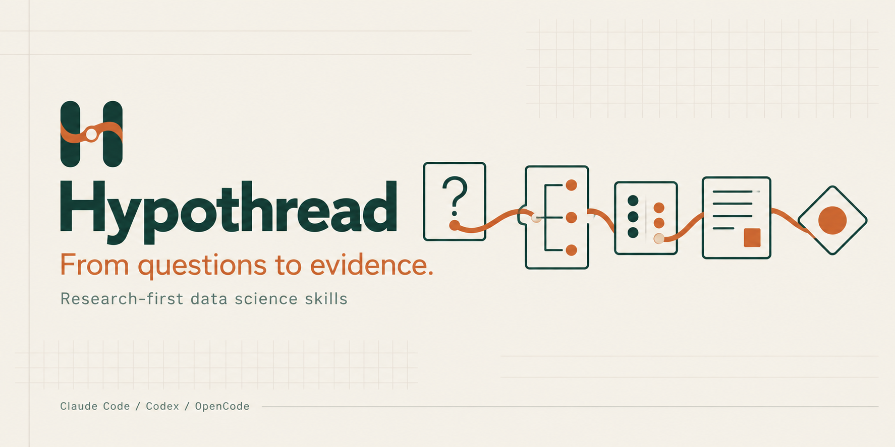
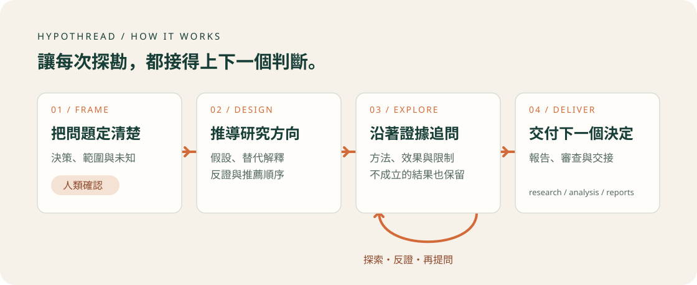

<p align="center">
  
</p>

<h1 align="center">Hypothread · 問脈</h1>
<p align="center"><strong>把問題想清楚，讓分析有據可循。</strong></p>
<p align="center">給資料科學家與分析師的 AI 協作技能。從問題定義、假設推演，走到可追溯的決策報告。</p>
<p align="center"><strong>Claude Code · Codex · OpenCode</strong>　／　6 個核心技能　／　MIT</p>
<p align="center">
  <a href="#開始使用">開始使用</a> ·
  <a href="#看一次它怎麼工作">看一段探勘</a> ·
  <a href="README.en.md">English</a>
</p>



你提出一個業務問題，Hypothread 引導 AI 先整理已知、未知與替代解釋，和你確認研究範圍，再擬定分析計畫。每次追問都能接著已有的假設與證據往下走。

- **先釐清問題。** 目標明確就開始；存在影響方向的歧義時再討論。
- **讓探索接得起來。** 每輪保存方法、結果、反證與下一步，追問時沿用已有脈絡。
- **把成果留在專案裡。** 資料、程式、參數與報告依用途整理，換對話或工具也能接續。

## 開始使用

想先看懂技能如何配合，請讀 [指令與工作流指南](docs/skill-guide.md)：包含目前入口、觸發政策、使用範例與 Mermaid 工作流程。

先安裝一次，選擇你使用的 CLI，勾選所需技能（建議完整安裝）：

```bash
npx skills add https://github.com/Zenobia000/iSpan_python-FE_DM-cookbooks/tree/skills -g
```

需要 Node.js 22.20 以上；初始化腳本使用 Python 3.9 以上。分析套件依你的題目環境準備。

接著，在你自己開的分析資料夾啟動 CLI：

| 工具 | 第一次輸入 | 開始研究 |
| --- | --- | --- |
| Claude Code | `/lab-init 初始化目前專案` | `/research 我要研究……，資料在……` |
| Codex | `$lab-init 初始化目前專案` | `$research 我要研究……，資料在……` |
| OpenCode | `使用 lab-init skill 初始化目前專案，並建立 OpenCode 指令` | `/research 我要研究……，資料在……` |

OpenCode 首次用自然語言載入技能；初始化後可用 `/lab-init`、`/research`、`/eda` 等指令。既有檔案保留，重跑只補缺少部分。一個題目就是一個專案，新題目由你另開資料夾。

## 看一次它怎麼工作

以下為互動示意，未執行統計分析，也未附上範例中的資料。

> **你**：夜班良率看起來比較低，我想知道值不值得安排製程調查。
>
> **Hypothread／research**：整體差異可能混合了產品與設備組成。我建議先把問題定為：在可比較的產品、設備與負載條件下，班別與良率是否仍有具業務意義的關聯？這次分析用來判斷是否值得現場調查。請確認範圍與用途。
>
> **你**：確認，先看最近三個月的 A 產線。
>
> **Hypothread／research**：我會先核對資料品質與產品組成，再比較可比群組，最後檢查不同期間是否穩定。每步記下假設、替代解釋與反證條件。
>
> **你**：後續也想查差異是不是集中在少數設備。
>
> **Hypothread／eda**：這能檢查設備組成是否影響整體差異。我會接著既有計畫評估設備層級比較，保留整體結果供對照，並回報效果量、樣本與不確定性。

你校正領域邏輯、資源限制與決策邊界；AI 負責推導研究方向、執行工具並回報依據。已確認範圍內可以連續工作，核心問題改變時再重新確認。



## 把它用在哪裡

| 你的題目 | 可以怎麼開始 | 希望得到什麼 |
| --- | --- | --- |
| 品質、停機或營運異常 | 釐清比較條件，追查產品、設備與時間效應 | 值得進一步調查的關聯與證據缺口 |
| 缺少直接量測 | 以現有欄位推演代理特徵，交代機制與驗證方式 | 可以被否決或驗證的候選假設 |
| 客群、留存或行為差異 | 定義觀測單位與期間，檢查組成與混雜 | 可比較的效果估計與限制 |
| 候選警報與業務決策 | 提取白盒條件，再比較誤報漏報與成本情境 | 可供審查的規則、效益假設與試行建議 |

只做探索也可以交付，不必補做模型、規則或 ROI。

## 安裝後，你會有什麼

| 工作 | 技能 |
| --- | --- |
| 建立目前題目的資料夾骨架 | `lab-init` |
| 釐清問題、整理素材、接續研究 | `research` |
| 自由探索、繪圖與檢查假說 | `eda` |
| 特徵工程、建模、調參與推論 | `model-fit` |
| 審查實際計算與主張 | `analysis-review` |
| 整理報告與交接 | `report` |

方法 references 與產出模板隨技能封裝，按需讀取。統計計算由工具實際執行；報告骨架保留必要證據，敘事與圖型依問題調整。圖表預設使用 Seaborn／Matplotlib。

```text
你的分析專案/
├── research/     問題、筆記與結論，可合併文件
├── materials/    external／generated
├── data/         raw／processed／features
├── analysis/     notebooks／scripts
├── config/       需要抽離才存設定，可按模型分檔
├── reports/      圖表、分析結果與報告
└── artifacts/    模型、預測與必要紀錄
```

目錄最多兩層，檔名與方法依題目決定。換對話時先讀已有筆記，目標清楚就開始；模板不是開工條件。數據、素材與產物預設忽略，分享前仍需檢查敏感內容。

## 方法與可信度

Hypothread 將「假設、觀察關聯、獨立驗證、介入成效」分開陳述。分析準則要求效果量、樣本、不確定性、多重比較及資料洩漏檢查，重要主張連回實際計算。

新增入口已納入本機套件、初始化、可攜資源與檔案保留測試；新版尚未完成從 GitHub 安裝驗收。完整模型對話與 OpenCode TUI 的端到端分析驗收仍待進行。

套件採 MIT 授權；CLI 的模型使用與運算費用依你的環境計算。

## 文件

- [技能指南與流程圖](docs/skill-guide.md)
- [專案資料夾](docs/project-layout.md)
- [Kaggle 適用性與限制](docs/kaggle-readiness.md)

<details>
<summary>給維護者：來源與發行</summary>

`skills/` 是方法與角色的單一來源。產生器輸出 Claude Code 入口、Codex／OpenCode 共用技能，以及 OpenCode 的薄指令轉接。輕量 `skills` 分支由建置工具產生，不含歷史教材。

```bash
python3 tools/render_skills.py --write
python3 tools/render_skills.py --check
python3 -m unittest discover -s tests -v
python3 tools/build_release.py --out /tmp/hypothread-release
```

[開發文件地圖](https://github.com/Zenobia000/iSpan_python-FE_DM-cookbooks/blob/feat/agentic-decision-analysis/docs/README.md) · [歷史教材](https://github.com/Zenobia000/iSpan_python-FE_DM-cookbooks/tree/feat/agentic-decision-analysis/archive)

</details>
