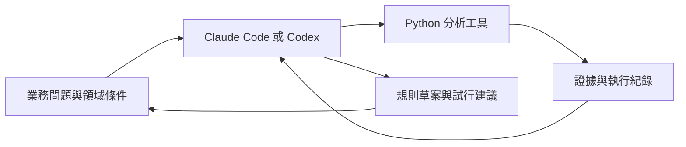

# Claude 與 Codex 原生決策分析專案

讓 Claude Code 或 Codex 直接在 repository 中完成「提出假設、執行工具、檢查證據、形成決策建議」的循環。四個分析環節共用可執行的 Python 工具、設定與交接紀錄，agent 負責領域推理、選擇下一步與解讀結果。

業務架構見 [AI 協作決策分析架構](../data_mining_course/docs/AI協作決策分析架構.md)，執行流程見 [WORKFLOW.md](WORKFLOW.md)。



## 快速開始

在 repository 根目錄執行；沿用既有核心依賴，不需 API key、外部資料集或模型下載。

```bash
uv sync --locked
uv run --locked python -m agentic demo --out /tmp/decision-demo-001
uv run --locked python -m unittest discover -s agentic/tests -v
```

開啟產出目錄中的 `report.md` 查看圖表與效益表，`handoff.md` 用於下一次對話或另一位 agent 接手。示範使用固定亂數種子的合成資料，所有成本與改善比例皆為假設。

## 在 agent 中使用

從 repository 根目錄啟動 Claude Code 或 Codex，即可載入專案指引。這裡的「原生」指兩個工具的 repository 指引與技能入口；Python 工具本身不會呼叫模型或自動啟動其他 agent。

**Claude Code**

```text
/decision-analysis 使用合成資料完成四環節示範，將證據存到 /tmp/decision-claude-001。
```

**Codex**

```text
使用 $decision-analysis 完成四環節示範，將證據存到 /tmp/decision-codex-001。
```

也可直接要求：「請讀 agentic/WORKFLOW.md，檢查這份 Schema，先提出代理特徵假設與需要我確認的領域問題。」不需要一開始就跑完整流程。

專案指引以根目錄 `AGENTS.md` 為共用來源，`CLAUDE.md` 使用 import 載入。技能分別位於 `.agents/skills/decision-analysis/` 與 `.claude/skills/decision-analysis/`，兩個精簡入口指向同一份工作流程。

## 使用自己的資料

1. 將資料放在不提交的路徑，例如 `/tmp/factory.csv`。
2. 複製 `example.config.json` 到本機路徑，修改欄位、時間切分、異常定義、代理特徵與成本參數；真實資料請將 `dataset_kind` 改為 `observed`。
3. 確認特徵在預定決策時間已可取得。資料表中存在該欄位，不代表當時就能取得。
4. 執行以下指令，並讓 agent 讀取結果、整理問題與下一步。

```bash
uv run --locked python -m agentic analyze \
  --data /tmp/factory.csv \
  --config /tmp/factory.config.json \
  --out /tmp/factory-analysis-001
```

輸出目錄必須尚未存在；失敗後保留該次檔案以便排查，修正後使用新目錄。設定檔中的 `features` 是人與 agent 決定的候選清單；工具不會根據驗證結果反覆自動挑選特徵。

## 工具範圍

| 環節 | 已實作 | 需要 agent 與人類補足 |
| --- | --- | --- |
| 代理特徵 | 過去至當下的滾動標準差、相鄰變化率與理由紀錄 | Schema 解讀、物理或業務機制、可取得性及領域驗證 |
| EDA | 開發集 Spearman、BH 校正、樣本數、前五項圖表 | 檢定假設、業務效果門檻、混雜因素與序列相依處理 |
| 規則 | 深度 2 決策樹、葉節點條件、獨立後期資料評估與錯誤矩陣 | 樣本充分性、警報動作、試行與 SOP 採用 |
| 商業影響 | 相同期間的成本、淨效益與多情境 ROI | 真實成本來源、行動效果、敏感度解讀與實測 |

目前資料介面限定**單一設備、每筆時間唯一、連續數值良率目標**，異常定義為 `target < event_below`。資料會依時間排序；多設備須先分開分析。滾動視窗按筆數計算，缺值不插補；EDA 逐欄排除缺值，規則分析僅使用完整列，排除筆數寫入 manifest。

Spearman 與 Wilson 區間的推論假設不一定適用於時間相依資料；工具會輸出此限制。分析不包含 ANOVA、卡方、關聯法則、因果估計或自動部署。需要這些方法時，依資料與任務新增工具及相應驗證。

## 每次執行的證據

| 檔案 | 用途 |
| --- | --- |
| `manifest.json` | 完成狀態、輸入與設定 SHA-256、設定快照、套件版本、時間邊界與缺值排除數 |
| `proxies.json` | 代理特徵定義、理由與待驗證狀態 |
| `eda.json` 與 `eda-*.png` | 開發集關聯證據與圖表 |
| `rules.json` | 全部葉節點的條件、開發／驗證涵蓋率、事件比例、區間與驗證錯誤矩陣 |
| `impact.json` | 假設成本、期間與情境結果 |
| `report.md` | 供人與 agent 閱讀的證據摘要 |
| `handoff.md` | 已完成事項、待確認事項與續作提示 |

原始商業資料、設定快照與產出可能含敏感內容，維持在本機，提交前逐項檢查。本 repository 的 `.gitignore` 已排除 `agentic/artifacts/` 與常見資料／產出格式。

## 實作依據

- [OpenAI 專案客製化](https://learn.chatgpt.com/docs/customization/overview)與[Codex Skills](https://learn.chatgpt.com/docs/build-skills)：共用專案指引與 `.agents/skills` 入口。
- [Claude Code 專案記憶](https://code.claude.com/docs/en/memory)與[Claude Code Skills](https://code.claude.com/docs/en/skills)：`CLAUDE.md` import 與 `.claude/skills` 入口。

這些入口已依官方文件設定；CLI 的實際技能載入仍受安裝版本與使用者設定影響。
