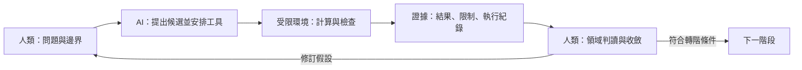

# AI 協作決策分析架構白皮書

> 從資料科學工作流的範式轉移，到 Claude Code／Codex 原生 Harness 的方法與設計。
>
> 本文提出以領域知識驅動、以可重現證據推進的協作架構，供資料團隊、領域專家與決策者共同規劃專案。製造業案例、目標、門檻與金額均為示意，未代表實測成果；Harness 目錄與狀態範例為參考設計，實際能力以專案實作及 CLI 版本為準。

現行專案先由 AI 推薦並界定研究問題、取得人類對具體版本的確認，再擬定假設、替代解釋與分析計畫；各題資料、程式和報告使用獨立目錄。操作見 [研究流程與專案目錄](research-workflow.md)。

本專案的現行目錄與使用方式見 [文件地圖](README.md)及 [Harness 操作](harness.md)；特徵工程的方法來源見 [參考文件](references/README.md)。

## 一、範式轉移：從手工分析到人機協作的決策工作流

資料科學的工作重心正在移動。當 AI 能協助撰寫資料轉換、執行統計分析、修正程式並整理結果，團隊有機會把更多時間投入問題定義、領域推理與行動選擇。分析人員的價值，也更集中在判斷「什麼值得計算、證據是否可信、結果應如何改變決策」。

這項轉變的核心，是重新分配人的注意力與工具的執行責任。本文主張採用一種「宏觀線性、微觀迭代」（Macro-Linear & Micro-Iterative）的工作方式：專案沿著定義問題、分析、建模與決策推進；每個階段內，則由人類設定問題與邊界，AI 執行工具並回報證據，再由人類判讀、修訂假設或決定前進。

### 1.1 傳統流程的瓶頸：領域思考被實作成本擠壓

傳統資料科學流程常被畫成一條直線：問題定義、資料準備、探索分析、建模、評估、部署。實務上，一個看似簡單的問題，例如「週五夜班的異常是否集中在特定機台」，可能需要重新對齊時間、調整分組、撰寫轉換、處理例外、繪圖，再回頭確認比較是否公平。

這些工作都有必要，但當每個新切角都伴隨大量手動實作，探索成本就會限制提問的數量與深度。團隊可能產出許多圖表，卻沒有時間追查背後機制；也可能取得更高模型分數，仍無法回答現場應在什麼條件下採取什麼行動。

因此，真正需要改善的是從「提出問題」到「取得可判讀證據」的往返成本，以及從「資料模式」到「業務行動」之間的斷點。

### 1.2 Before／After：能力與責任如何重新分配

以下描述常見瓶頸與本文倡議的工作方式。成熟的傳統團隊同樣重視領域知識、驗證與可解釋性；AI 協作讓這些原則有機會以更低的執行成本持續落實。

| 維度 | Before：以手動實作為主 | After：AI 協作與 Harness 支援 |
| --- | --- | --- |
| 角色定位 | 資料科學家同時承擔統計設計、資料處理、程式除錯與溝通 | 資料科學家兼任探查長與架構師，主導領域定義、證據標準與流程設計；AI 承接可驗收的執行工作 |
| EDA | 逐欄撰寫 `groupby`、檢定與圖表，人工整理大量結果 | AI 在指定範圍內掃描，依效果量、樣本數、不確定性與業務意義排序，呈現優先審查的圖表 |
| 特徵與資料缺口 | 新假設需要重新撰寫轉換；缺少直接量測時容易停滯 | AI 根據 Schema 與領域機制提出代理特徵，人類審查理由、可取得性與驗證方案 |
| 建模與產出 | 容易以整體 Accuracy 或模型複雜度作為進度指標 | 依決策需要提取可解釋的候選規則，回報誤報、漏報、涵蓋率與成本 |
| 微迭代 | 提出切角、改程式、除錯、看結果，往返成本偏高 | 提出切角、AI 執行、核對證據、修訂問題，縮短重複實作的等待 |
| 知識保存 | 假設、限制與決定散落於對話和 notebook | 以版本化文件、執行紀錄與交接檔保存決策脈絡 |
| 完成標準 | 完成分析報告或訓練出模型 | 形成有證據支持的試行建議，並能追蹤實際效果 |

「數小時縮短為數分鐘」可以作為特定重複任務的改善目標，仍須用相同任務的前後紀錄驗證。資料規模、計算資源、工具成熟度與人工審閱負擔，都會影響實際速度。

### 1.3 核心命題與適用範圍

**AI 協作決策分析的價值，在於更快取得可信證據，讓領域判斷轉化為可驗證的行動。**

這套方法尤其適合已有表格或時間序列資料、但關鍵量測不足、分析人力有限，或尚未具備複雜模型上線條件的專案。團隊可以先交付代理特徵、重點關聯、候選警報與效益情境，據此決定是否補資料、試行或擴充模型。

若資料連基本時間、目標定義或觀測單位都無法確認，第一階段的合理成果可能是一份補資料計畫。若任務需要多模態表徵或複雜預測模型，也可沿用本文的證據與交接原則，再選擇合適模型。

## 二、背景演進：從程式輔助到具備執行能力的 AI

### 2.1 四種工作方式的累積

從手動分析走向 AI 協作，可以用四種逐步累積的能力理解。這是工作方式的分類，各種方式仍會並存。

| 工作方式 | 新增能力 | 仍需處理的問題 |
| --- | --- | --- |
| 手動腳本與 notebook | 分析可被程式重現，能反覆計算與繪圖 | 新假設仍需大量人工實作，執行順序與判斷理由容易散落 |
| 套件化管線與自動化建模 | 把既定清理、訓練與評估流程標準化 | 問題、目標與特徵若定義錯誤，自動化會持續執行錯誤方向 |
| 對話式 AI 與程式補全 | 快速生成程式、解釋方法、提出候選假設 | 文字回答與實際執行結果可能脫節，仍需人搬運資料與核對 |
| 可操作工具的 AI agent | 在授權環境中讀檔、執行程式、查看結果，再調整下一步 | 需要管理上下文、權限、狀態、驗證與交接，防止錯誤反覆擴大 |

這段演進讓協作從「請 AI 建議怎麼分析」，延伸到「請 AI 執行一個有明確邊界、輸入與驗收條件的分析任務」。程式可執行，不代表方法正確；結果可重現，也不代表結論足以支持介入。

### 2.2 AI、分析工具與 Harness 各自負責什麼

在本文架構中，語言模型負責解讀任務、提出假設、組織工具操作與說明結果；Python、統計套件與資料庫負責實際計算；Harness 則管理任務如何開始、使用哪些資料與工具、留下什麼證據，以及何時可以轉入下一階段。

Claude Code、Codex 這類工具已提供 agent 執行環境。本文的「原生 Harness」是在既有 CLI 之上，補上資料分析專案的上下文、狀態與證據契約，優先沿用工具原生能力，減少另建編排框架的負擔。

### 2.3 自動化越快，驗證責任越集中

當 AI 能快速產生大量特徵與比較，探索空間會擴大，偶然關聯、重複試驗與資料洩漏也更容易累積。單純增加產出量，可能讓人工審閱成為新的瓶頸。

因此，現代協作的設計需要同時降低執行成本與控制結論品質。每個迴圈都應回答四件事：這次驗證哪個假設、哪些資料可以使用、何種證據足以支持下一步，以及什麼情況應停止或縮小主張。

## 三、方法總體：宏觀線性、微觀迭代

### 3.1 宏觀主線：依證據成熟度推進

專案主線分為四個階段。每階段都有明確問題與可檢閱成果，讓團隊知道目前是在提出假設、探索關聯、驗證規則，還是評估行動。

| 階段 | 核心問題 | 對應分析環節 | 階段成果 |
| --- | --- | --- | --- |
| Phase 1 領域定義與資料對齊 | 要做什麼決定，資料能觀察到什麼？ | 代理特徵推演與資料缺口盤點 | 決策定義、資料契約、候選假設 |
| Phase 2 降噪型資料探勘 | 哪些關聯值得投入領域判讀？ | 高價值 EDA 篩選 | 重點圖表、完整比較紀錄與證據摘要 |
| Phase 3 白盒特徵與規則提取 | 哪些條件能形成可操作的候選警報？ | 白盒決策規則提取 | 凍結規則、獨立驗證與操作草案 |
| Phase 4 業務影響與決策交付 | 值得如何試行，成效如何衡量？ | ROI 情境分析與故事化交付 | 效益情境、決策文件與試行計畫 |

宏觀線性表示責任與證據依序累積。若後續發現目標定義不適當或特徵在決策時不可取得，就應退回上游修訂，並重新檢查受影響的下游成果。

### 3.2 微觀迴圈：從領域問題到下一個判斷

專案啟動時先完成「AI 定義問題 → 人類確認 → AI 推導研究計畫」。AI 應承擔來源比較、假設形成、反證條件與分析順序的設計，向人說明推薦理由；不把方法選擇切成缺乏依據的分支。

每個 Phase 內部都重複同一個迴圈：



發散必須有範圍，例如限定假設數、比較群組、時間窗與計算預算。驗證要由工具產生可核對的數字與紀錄。收斂則決定保留、修改、否決或補資料，並將理由寫入專案狀態。

一個微迴圈的最小單位，是一項能接受或否決的分析任務，例如「在相同產品與負載下，檢查週五夜班的壓力波動是否仍較高」。任務應交付計算方法、樣本數、結果、限制與下一步，讓下一輪能從既有證據接續。

### 3.3 人與 AI 的責任契約

| 參與者 | 必須承擔的責任 |
| --- | --- |
| 業務與領域專家 | 定義目標、解釋設備或業務機制、確認物理邊界及可行處置 |
| 資料分析人員 | 設計切分與統計方法、核對程式與資料品質、評估洩漏及結果穩定性 |
| AI agent | 在授權範圍提出假設、執行工具、保存證據，清楚區分結果與推測 |
| 決策者 | 決定投入、試行範圍與採用方式，承接行動結果 |

同一人可以兼任多個角色，但每項責任都需要可辨識的承接者。人類審查應集中在問題定義、方法改變、規則採用與業務行動；已授權範圍內的重複計算可以持續執行。

## 四、四階段工作流：由假設走向可試行的決策

### 4.1 Phase 1：領域驅動的定義與資料對齊

**目的：將業務需求轉成可量測問題，確認資料缺口及代理特徵的合理性。**

以「降低異常停機」為例，團隊先定義設備範圍、異常事件、觀測單位與行動時點，再設定 SMART 目標，例如「在三個月試行期間，使指定產線每千運轉小時的非預期停機時數，相對基準下降 15%」。這個降幅是目標，後續仍需驗證可行性。

資料契約應涵蓋欄位定義、單位、感測範圍、取樣頻率、資料延遲、運轉模式與缺值意義。物理限制必須依設備確認：例如攝氏溫度可為負值，不能直接把「溫度不得為負」當成通用規則。

**微迴圈示例**

1. 人類指出缺少震動資料，要求檢查現有訊號能否提供設備異常線索。
2. AI 根據 Schema 提出電流波動、耗電變化與負載正規化指標，逐項說明機制假設。
3. 人類確認電流只有每分鐘平均值，否決「高頻震動推估」的描述，保留分鐘尺度負載波動假設。
4. AI 補上特徵公式、取樣限制與驗證計畫，將尚未確認的機制保留為假設。

| 代理特徵契約 | 必須記錄的內容 |
| --- | --- |
| 欲觀察的概念 | 設備負載不穩定；目前缺乏直接震動量測 |
| 候選定義 | 同一設備在決策時點前 10 分鐘的電流標準差，單位 A |
| 領域理由 | 在可比較模式下，負載變動可能反映於電流；仍可能受產品與轉速影響 |
| 當下可取得性 | 確認原始紀錄何時到達；有延遲時，視窗終點須相應提前 |
| 驗證方式 | 對照維修事件，按模式分層；有震動量測時再檢查代理效度 |
| 限制與狀態 | 分鐘平均值無法還原高頻振動；現階段為待驗證的異常代理指標 |

**轉階條件：**決策、目標、資料可用時間與限制已記錄；候選特徵有理由及驗證方式；在任何目標導向篩選前，已保留獨立後期資料，並規劃開發資料內的調整與驗證方式。

### 4.2 Phase 2：降噪型資料探勘與證據篩選

**目的：減少人工審閱負擔，優先呈現具有業務意義、值得追查的關聯。**

AI 可在開發資料上批次檢查缺值、分布、偏態、欄位關聯與分組差異。方法應依樣本單位及假設選用；同一機台連續量測具有時間相依性，不能直接把每筆紀錄當成獨立樣本。常態性檢定、ANOVA、相關分析或其他方法，都需要對應明確問題。

大量比較時，必須處理多重檢定並保存完整比較集合。預先限定比較與使用適當校正，是避免只挑中偶然差異的重要措施。[NIST 多重比較說明](https://www.itl.nist.gov/div898/handbook/prc/section4/prc473.htm)

**微迴圈示例**

1. AI 回報週五夜班壓力波動較大，同時列出效果量、群組樣本數、不確定區間與多重比較處理。
2. 人類提出「可能與耗材使用週期有關」的假設，要求在相同產品、負載與設備下重新比較。
3. AI 繪製分設備趨勢圖，檢查耗材更換時間與群組差異；若缺乏耗材紀錄，明列無法驗證的部分。
4. 人類決定追查、降級或否決該線索；AI 保存本輪新增問題及分析結果。

前五張圖表是簡報入口。完整報告仍須保留未入選項目與排序依據，並區分：效果具業務意義且有證據支持、效果可能重要但證據不足，以及目前不值得優先追查的結果。`p > 0.05` 不足以證明沒有關係，也不能據此宣稱「已過濾 80% 雜訊」。

追加的新切角屬於探索，不能因重複調整後達到顯著，就寫成預先指定的驗證成果。若留出的資料被拿來挑選圖表、特徵或門檻，就需要另備獨立驗證資料。

**轉階條件：**每項優先線索具有業務門檻、效果量、樣本數、不確定性、比較方法與限制；關聯與機制假設分列；後續要建構的特徵能對回領域問題。

### 4.3 Phase 3：白盒特徵工程與決策規則提取

**目的：把有理由的特徵轉成可驗證、可操作的候選警報。**

人類先設定防止前瞻偏差的邊界，AI 再於開發資料建立滾動統計、變化率或領域比值。所有特徵只能使用決策當下已取得的資料；需要學習的插補、編碼、縮放及特徵選擇參數，必須在訓練資料或各訓練折內估計。[scikit-learn 資料洩漏與 Pipeline 指引](https://scikit-learn.org/stable/common_pitfalls.html#data-leakage)

**微迴圈示例**

1. AI 依已保留的假設生成特徵，回報單位、時間窗、缺值與無限大處理。
2. AI 訓練深度不超過 3、具有最低葉節點樣本數限制的決策樹，提取候選條件。
3. 人類否決缺乏物理意義的比值，保留可量測的溫度與電流波動條件，要求檢查門檻穩定性。
4. 團隊在開發流程中完成調整後凍結規則，再以獨立後期資料評估；若據此修改規則，需重新安排獨立驗證。

樹的分裂增益與特徵重要性可協助探索，但採用判準還須包含警報涵蓋率、precision、recall、誤報與漏報、事件樣本數，以及不同設備和期間的穩定性。若採用關聯法則，也須呈現支持度、信賴度、提升度與基準率。

```text
候選條件：溫度 > 85°C，且過去 10 分鐘電流標準差 > 2 A
適用範圍：已驗證的設備、產品與運轉模式
資料條件：特徵已到達；缺值時依預定策略標為無法判定
建議動作：提示人工檢查，依現場程序確認設備狀況
必備證據：觸發樣本數、事件比例、誤報漏報與時間外驗證結果
採用狀態：候選警報；由領域確認、獨立驗證與試行共同決定是否納入 SOP
```

白盒優先適用於需要清楚操作條件的情境。淺層樹仍可能過度擬合；若需用較複雜模型比較效能，也應保留相同的驗證與成本標準。

**轉階條件：**完成洩漏、單位與數值品質檢查；候選規則有凍結版本、驗證證據及可行動作；驗證不足的規則維持探索狀態。

### 4.4 Phase 4：業務影響、故事化交付與試行設計

**目的：讓決策者理解證據、投入與不確定性，選擇合適的試行方案。**

AI 可協助把規則與模型解釋轉成自然語言，組織為「目前問題、發現了什麼、證據有多強、建議做什麼、投入多少、如何驗證」的決策敘事。若使用 SHAP，應說明它解釋的是模型預測，不能據此推定改變特徵就能造成相同業務效果。

**微迴圈示例**

1. 人類提供停機成本來源、平均事件時長、檢查成本與可接受的警報量。
2. AI 將歷史觀測、外部估計及介入效果假設分列，計算保守、基準與樂觀情境。
3. 人類檢查是否重複計算產能、報廢或人力效益，補上現場執行限制。
4. AI 形成決策 Markdown 與試行方案，保留推算鏈及待驗證假設。

以同一個月、同一幣別的純假設數字說明：

| 參數 | 數值 | 證據狀態 |
| --- | --- | --- |
| 每月非預期停機事件 | 4 次 | 情境假設；實務應由事件紀錄估計 |
| 每次平均停機時長 | 1 小時 | 情境假設；需與事件定義一致 |
| 每停機小時損失 | 10,000 元 | 情境假設；需財務確認成本範圍 |
| 可避免事件比例 | 保守 10%、基準 25%、樂觀 50% | 待試行驗證的介入效果假設 |
| 每月新增執行成本 | 5,000 元 | 情境假設；包含檢查、誤報處理等 |
| 初期導入成本 | 5,000 元 | 情境假設；此例全額列入首月 |

```text
期間可避免損失 = 基準事件數 × 可避免比例 × 每次停機時長 × 每小時損失
期間總投入 = 期間新增執行成本 + 列入該期間的導入成本
期間淨效益 = 期間可避免損失 − 期間總投入
期間 ROI = 期間淨效益 ÷ 期間總投入
```

| 首月情境 | 推估可避免事件數 | 可避免損失 | 總投入 | 淨效益 | ROI |
| --- | --- | --- | --- | --- | --- |
| 保守 | 0.4 次 | 4,000 元 | 10,000 元 | −6,000 元 | −60% |
| 基準 | 1 次 | 10,000 元 | 10,000 元 | 0 元 | 0% |
| 樂觀 | 2 次 | 20,000 元 | 10,000 元 | 10,000 元 | 100% |

事件數的小數代表情境期望值。這裡的「避免兩次、減少 20,000 元損失」依賴每次一小時與 50% 可避免比例，且尚未扣除投入；不能直接宣稱為已實現的節省。總投入為零或未知時，先呈現可避免損失與成本缺口。

**交付條件：**估算與實測分列、期間與成本口徑一致，並明定試行對照、觀測期間、責任人及停止條件。可透過合適的對照或分階段導入設計評估效果，避免將產品組合或產量變化當成警報介入的功效。

## 五、原生 Harness：將協作方法變成可持續執行的契約

### 5.1 為何需要專案層的 Harness

長對話容易讓目標、欄位限制與已否決假設逐漸失去可見性；不同 session 也可能使用不同資料版本，重複探索已做過的切角。當執行越來越自動化，團隊就需要明確保存「這次在做什麼、依據哪一份證據、哪些事情尚未獲得確認」。

本文採用 CLI 原生、檔案驅動的輕量設計：以專案指引保存共識，以技能封裝方法，以狀態契約標示進度，以程式檢查結構性條件，再由人類承接領域與業務判斷。第一版可由人操作，之後再將穩定的重複工作交給腳本或原生 hook。

這種架構適合既有 repository、少量協作者與可明確切分的分析任務。當專案需要大量平行任務、長時間排程或跨系統交易時，才進一步評估專門的編排與狀態服務。

### 5.2 參考目錄：上下文、方法、工具與證據

以下是可移植的概念配置。檔名與欄位由團隊定義，並非 Claude Code 或 Codex 共同內建的標準。

```text
ai_ds_workspace/
├── AGENTS.md                      # 專案共用規約與文件入口
├── CLAUDE.md                      # Claude 專案入口，引用共用規約
├── .harness/
│   ├── context.md                 # 業務目標、欄位字典、可取得性、限制
│   ├── state_machine.yaml         # 階段、證據版本、下一步與轉階條件
│   └── hooks/
│       ├── pre_eda_check.md        # EDA 前的審查規格
│       └── post_feature_check.md   # 特徵完成後的審查規格
├── skills/
│   ├── stat_profiler.md            # 統計分析與排序準則的共用本文
│   ├── feature_miner.md            # 特徵與候選規則的共用本文
│   └── business_translator.md      # 效益推算與交付準則的共用本文
├── .agents/skills/                 # Codex 原生技能入口
│   └── stat-profiler/SKILL.md      # 引用共用方法文件；其他角色同理
├── .claude/skills/                 # Claude Code 原生技能入口
│   └── stat-profiler/SKILL.md      # 引用同一份共用方法文件
├── tools/                         # 可重現計算與契約檢查程式
├── data/                          # 受控輸入位置；真實資料不提交
└── reports/
    └── run-001/                    # 每輪獨立產出，後續使用新目錄
        ├── manifest.json          # 輸入／設定識別、版本、命令與完成狀態
        ├── evidence/              # 統計表、圖表、規則與檢查結果
        ├── review.md              # 人工判斷、否決理由與待確認項目
        ├── decision.md            # 本輪可支持的決定及效益情境
        └── handoff.md             # 下一個 session 的接續入口
```

`skills/` 下的普通 Markdown 可由提示明確要求讀取。要使用工具原生技能探索與調用，還需建立相應 `SKILL.md` 入口。Codex 與 Claude Code 的技能位置及載入方式，應分別依官方文件配置。[Codex Skills](https://learn.chatgpt.com/docs/build-skills)、[Claude Code Skills](https://code.claude.com/docs/en/skills)

### 5.3 Context Memory：讓決策背景成為可核對的記憶

`context.md` 應保留穩定且影響分析正確性的內容：決策目標、觀測單位、目標欄位、可用時間、物理限制、禁用欄位、切分策略與已確認事項。大量結果則透過證據路徑引用，避免上下文被歷史輸出淹沒。

例如 PCB 專案可明定：「在製程結束前決定是否人工檢查，以後續量測的 `defect_rate` 作為結果；`post_test_score` 在決策之後才取得，禁止作為預測特徵。」目標可以在事後量測，但用於當下決策的輸入必須當時可得。

每輪開始時，agent 應讀取專案指引、目前狀態與上一輪交接，再只載入任務需要的證據。Codex 可透過 `AGENTS.md` 提供專案指引；Claude Code 可使用 `CLAUDE.md` 及其引用機制。自行命名的 `.harness/context.md` 則需要由入口文件或任務明確引用。[Codex 專案指引](https://learn.chatgpt.com/docs/agent-configuration/agents-md)、[Claude Code 專案記憶](https://code.claude.com/docs/en/memory)

### 5.4 宣告式 Skills：將專業方法封裝為可重用責任

技能應描述觸發情境、必要輸入、分析程序、驗收標準與交付格式。對資料科學而言，重點是讓方法可檢查，例如統計角色必須回報哪些不確定性，規則角色必須如何處理缺值與驗證。

| 技能角色 | 必要輸入 | 執行責任 | 必備產出 |
| --- | --- | --- | --- |
| `stat_profiler` | 決策問題、開發資料、比較群組與效果門檻 | 檢查方法假設，執行分析與多重比較處理，排序審閱優先度 | 完整比較表、優先圖表、樣本數、不確定性與限制 |
| `feature_miner` | 領域假設、時間契約、特徵與切分設定 | 建構特徵、檢查洩漏、探索並凍結候選規則 | 特徵定義、規則版本、驗證與數值品質結果 |
| `business_translator` | 證據摘要、成本來源、介入效果假設 | 比較情境、核對期間、整理決策敘事 | 觀測／假設表、ROI、敏感度與試行建議 |

這些是可由同一個 agent 依序承擔的責任。載入另一份技能文件，不代表啟動新的 subagent，也不代表取得獨立審查；若需要獨立覆核，須另行安排具有明確責任與證據範圍的審查程序。

### 5.5 State Contract：階段進度與證據版本必須一致

狀態檔的用途，是把進度與依據綁在一起。下面以 Phase 3 的候選規則審查為例，欄位僅示意專案契約：

```yaml
schema_version: 1
run_id: run-001
phase: 3
status: awaiting_review
context_revision: context-v2
input_revision: dataset-v1
validation:
  split_spec: split-v1
  independent_data_used: false
artifacts:
  candidate_rules: reports/run-001/evidence/rules.json
  checks: reports/run-001/evidence/feature_checks.json
review:
  required_for: adopt_candidate_for_trial
  decision: pending
  reviewer: null
  evidence_revision: rules-v3
next_action: review_rules_and_validation_plan
```

`independent_data_used: false` 表示這一步仍在審查候選與驗證計畫；後續實際讀取獨立資料後必須更新紀錄。狀態應區分可執行、執行中、待審查、需修訂與已完成，失敗時保留原因及恢復方式。

資料、特徵或規則改版後，下游結果可能失效。審查決定也應綁定當時的證據版本；不能把舊版規則的通過紀錄，直接沿用到新版規則。若要自動轉階，需由程式驗證狀態與證據，而非僅憑 agent 自行寫入「完成」。

### 5.6 Hooks：區分審查規格與實際攔截能力

`.harness/hooks/post_feature_check.md` 可以規定檢查事項，但這個檔案本身不會自動攔截工具。落實方式有三層：

| 層次 | 作法 | 能驗證的範圍 |
| --- | --- | --- |
| 文字檢查表 | agent 逐項核對並附證據，人類檢閱 | 判斷是否被明確提出；執行依賴協作者遵循 |
| 可執行檢查 | 程式檢查時間邊界、欄位、NaN、無限大、產物結構與版本 | 已實作條件是否符合，仍需處理檢查程式自身的正確性 |
| 工具事件與轉階控制 | 依 CLI 能力配置原生 hook，或由外層腳本控制下一步 | 在指定事件拒絕操作或阻止轉階；效果取決於實際設定 |

Claude Code 提供事件 hook 與對應控制規則；哪些事件可阻擋、如何回傳判定，須依官方規格實作，不能把事後檢查當成事前阻擋。[Claude Code Hooks](https://code.claude.com/docs/en/hooks)

`post_feature_check.md` 可採下列審查規格：

- **時間與洩漏：**特徵只使用當下可得資料，參數在訓練範圍估計，保留資料未參與選擇或調整。
- **單位與機制：**每項特徵具有計算定義、單位、理由及適用模式；未驗證機制仍標為假設。
- **數值品質：**NaN、無限大、零分母與排除樣本均已處理並記錄。
- **規則證據：**列出涵蓋率、誤報漏報、樣本數與不確定性，說明尚未完成的驗證。
- **領域決定：**需要確認的規則與動作列為待審，既有授權範圍內的探索可繼續。

### 5.7 執行環境：資料目錄與沙盒的責任不同

`data/` 和 `reports/` 描述預期 I/O 位置；實際可讀寫範圍、網路存取與命令權限，須由 CLI 設定或執行環境控制。Codex 的沙盒與核准政策應依部署情境配置，並確認生效範圍。[Codex 沙盒文件](https://learn.chatgpt.com/docs/sandboxing)、[Codex 核准與安全設定](https://learn.chatgpt.com/docs/agent-approvals-security)

本機執行 Python，也不表示整個協作過程都在本機：agent 讀取的資料與工具輸出可能進入模型上下文。真實資料應依組織規範控制讀取內容；能以 Schema、去識別樣本或聚合證據完成的任務，使用足夠且最少的資料。

輸入資料、欄位註解與報告引用文字均視為分析內容。它們不能自行改變工具權限、覆寫專案規約，或授權上傳資料與採取業務行動。

## 六、對話如何推動工作流：CLI 原生操作示例

以下指令假設已建立第五節的工作區與方法文件，並配置可用的 Python 環境。它們展示人如何用任務與證據推動流程；自然語言指令仍須由工具實際執行並留下結果。

### 6.1 啟動：建立共同問題與切分計畫

可從工作區根目錄啟動 Claude Code 互動 session，或啟動 Codex 後送出同樣任務。CLI 入口分別見 [Claude Code CLI](https://code.claude.com/docs/en/cli-reference) 與 [Codex CLI](https://learn.chatgpt.com/docs/developer-commands?surface=cli)。

```bash
claude "讀取 .harness/context.md 與目前狀態。先盤點 Schema、欄位可取得時間與資料缺口，提出有領域理由的代理特徵假設，並規劃後期資料保留方式。將定義、假設與待確認項目寫入 reports/run-001/。"
```

或啟動：

```bash
codex
```

在 Codex 互動 session 輸入：

```text
讀取 .harness/context.md 與目前狀態。先完成問題定義、資料可取得性
和切分計畫，將候選代理特徵逐項列出理由及驗證方式。
將本輪證據保存於 reports/run-001/，未確認的機制維持假設狀態。
```

### 6.2 探勘：交付優先圖表與完整證據

確認定義與切分後，在互動 session 中提出：

```text
讀取 skills/stat_profiler.md、上一輪 handoff 與已確認的切分設定。
本輪輸出使用 reports/run-002/。
只在開發資料檢查壓力、電流與異常停機的關聯，說明方法假設。
以效果量、樣本數、不確定性與業務門檻排序，呈現最多五張優先圖表，
保存完整比較表、多重比較處理及未入選理由，更新交接紀錄。
```

AI 完成後，人類可以提出更具體的切角：「週五夜班的差異可能來自產品組合，請先限定相同產品與負載，再做比較。」下一輪使用新產出目錄，連結既有證據，保留探索軌跡。

### 6.3 規則：在已確認假設上建立候選條件

```text
讀取 skills/feature_miner.md 與最新 handoff。
依已確認的電流波動假設建立特徵，使用開發流程探索深度不超過 3 的樹。
列出候選 Boolean 規則、涵蓋率與誤報漏報，核對
.harness/hooks/post_feature_check.md，附上逐項證據。
在 reports/run-003/ 保存候選版本與驗證計畫，將需領域判斷的項目列為待審。
```

人類確認候選與驗證方案後，再執行獨立評估並保存結果。後續若需要調整門檻，先記錄修改理由與已使用資料，重新規劃驗證。

### 6.4 決策：從驗證結果轉成試行建議

```text
讀取 skills/business_translator.md、最新驗證與成本參數。
在 reports/run-004/ 分列觀測值、估計與假設，計算三種效益情境。
將規則表現、處置成本與效果不確定性整理成 decision.md，
提出試行範圍、比較方式、停止條件與追蹤指標，更新 handoff。
```

對話可以隨時中止或換 session；接手者應能透過狀態與證據續做，並辨認哪些決定仍待人類承接。

## 七、證據治理與交接：讓下一輪能延續本輪成果

### 7.1 每輪執行的最小證據包

| 產物 | 必備內容 | 用途 |
| --- | --- | --- |
| Manifest | run ID、資料與設定雜湊、程式版本、環境、命令、時間切分、排除數與完成狀態 | 確認結果來自哪次執行 |
| 分析證據 | 特徵公式、比較集合、統計結果、圖表與規則版本 | 重現計算與核對主張 |
| 審查紀錄 | 檢查結果、證據引用、接受／修改／否決理由與責任人 | 區分計算完成與決策確認 |
| 決策文件 | 證據摘要、行動條件、適用範圍、成本、情境及限制 | 支持投入與試行決定 |
| Handoff | 已完成、未完成、假設、驗證資料使用情形與下一步 | 支持跨 session 或跨協作者接續 |

雜湊可以協助辨識檔案是否改變，但不能單獨證明內容正確、審查獨立或批准者身分。重要採用決定仍須依組織的審查與權限制度確認。

### 7.2 接手與失敗恢復

接手者先核對 manifest、證據是否存在及版本是否一致，再閱讀 handoff。有效證據可以重用；上游定義改變時，從最早受影響的環節重算並建立新紀錄。

失敗執行應保留已產生的紀錄與錯誤原因，避免覆寫成表面成功的報告。原始商業資料、憑證、個人設定與執行產出不提交；可提交的是經檢查的共用規約、方法與程式。

### 7.3 證據成熟度決定可以主張到哪裡

| 成熟度 | 可以支持的主張 | 下一步 |
| --- | --- | --- |
| 領域假設 | 某訊號在機制上值得檢查 | 取得資料並設計比較 |
| 開發資料關聯 | 在指定資料與條件下觀察到模式 | 檢查混雜、凍結候選並獨立驗證 |
| 獨立規則驗證 | 規則在指定後期資料具有某種警報表現 | 確認處置可行性並規劃試行 |
| 現場介入評估 | 在指定試行與比較設計下觀察到成效 | 評估推廣範圍與持續監測 |

## 八、導入路徑與成效衡量

### 8.1 從一個決策開始，逐步建立自動化

第一步選擇一個有明確行動時點與成本的問題，完成問題、資料與可行處置的對齊。第二步跑完一個最小微迴圈，確認人能讀懂結果並據此改變判斷。第三步將穩定的計算與檢查封裝成工具及技能，再加入狀態管理與交接。最後，依獨立驗證與試行結果決定是否擴充。

這種導入順序讓 Harness 隨實際需求成長。若證據尚不足，交付補資料方案或否決某項假設，也可以是有價值的專案成果。

### 8.2 同時量測速度、證據品質與業務結果

| 面向 | 建議追蹤指標 | 解讀重點 |
| --- | --- | --- |
| 決策速度 | 提問到取得可判讀證據的時間、等待人工確認的時間 | 使用可比較任務，區分計算與審閱時間 |
| 分析成本 | 人工工時、模型使用費、運算費與返工次數 | 同時計入核對及修正 AI 產出的成本 |
| 證據品質 | 可重現比例、洩漏問題、外部期間穩定性與證據缺口 | 圖表或候選數增加，不直接代表品質提升 |
| 規則可用性 | 警報量、precision、recall、處理率與處置時間 | 確認現場有能力回應警報 |
| 商業成果 | 停機或報廢變化、投入成本、實測淨效益 | 估算與實測分列，說明比較設計及其限制 |

### 8.3 適用邊界與後續擴充

AI 能降低提出假設與執行分析的成本，仍無法補回不存在的量測、替代獨立驗證，或僅憑歷史關聯保證介入效果。代理特徵失效、樣本不足、警報處置不可行時，應回到資料與領域條件修訂方案。

當資料品質、規則穩定性與試行效果逐步成熟，團隊可擴充模型、接入持續監測或導入更完整的編排系統。整個架構的持續價值，在於每一輪都把領域問題、可重現證據與下一個決定接起來，讓分析真正進入業務運作。
