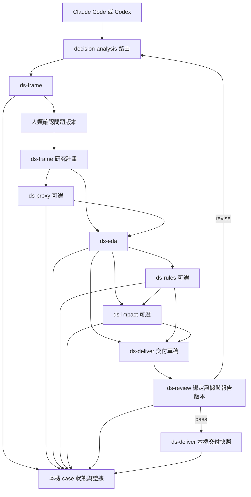

# 決策分析技能與執行 Harness

Claude Code 與 Codex 是執行 agent 的 host。本專案提供領域角色、工作契約、可續作狀態與證據驗收，讓 agent 根據問題選方法、執行工具、檢查結果，再決定下一步。適用範圍涵蓋客戶、交易、設備與其他表格資料，不預設要建模型。

研究方法與多專案目錄見 [研究工作流程](research-workflow.md)：先由 AI 定義問題並取得人類確認，再擬定研究計畫。

## 使用方式

clone 專案後從根目錄啟動 agent。已提交的技能入口可直接載入，harness 只用 Python 3.9 以上的標準函式庫；僅使用計算範例時才需要 `uv sync --locked`。

| 工作 | Claude Code | Codex |
| --- | --- | --- |
| 路由或續作 | `/decision-analysis` | `$decision-analysis` |
| 決策與分析計畫 | `/ds-frame` | `$ds-frame` |
| 代理特徵假設 | `/ds-proxy` | `$ds-proxy` |
| EDA 與假設驗證 | `/ds-eda` | `$ds-eda` |
| 現場規則 | `/ds-rules` | `$ds-rules` |
| 商業情境 | `/ds-impact` | `$ds-impact` |
| 證據審查 | `/ds-review` | `$ds-review` |
| 報告與交付 | `/ds-deliver` | `$ds-deliver` |

例如：「`/ds-frame` 我想知道哪些條件與良率下降有關，先讀我提供的 Schema，先推薦完整研究問題並與我確認，再擬定有假設與反證的計畫。」也可要求「使用 `$decision-analysis` 接手 `projects/quality`，從過期的證據開始處理」。

技能未被當次 host 發現時，可重新啟動 session，或請 agent 讀取相應模板與共用契約。模板沒有 host 專屬工具依賴，`{{SESSION_START}}` 的內容在 `skills/_shared/session.md`；不以格式通過宣稱真實 host 載入已完成驗證。

## 架構與可選路徑



`--goal eda` 可交付分析發現，`rules` 加上候選規則，`impact` 加上效益情境。代理特徵可省略；impact 可直接依 EDA 評估試行價值，不需要強行經過 rules。同一 host 可以切換角色完成全程，也可以跨 session 或跨 host 交接。

## 原始碼與執行狀態

```text
AGENTS.md                         共用路由與專案判準
CLAUDE.md                         載入共用判準
skills/<角色>/SKILL.md.tmpl        單一維護來源
skills/_shared/session.md         共用啟動 續作與登錄契約
.claude/skills/<角色>/SKILL.md     Claude 產生入口
.agents/skills/<角色>/SKILL.md     Codex 產生入口
tools/render_skills.py            雙 host render 與漂移檢查
tools/ds_harness.py               標準函式庫執行工具
tests/                            狀態與驗收行為測試
evals/                            真實 agent 的情境與評分規準
examples/factory_analysis/        可選的製造業計算範例
projects/<任務>/            本機資料與紀錄 不提交
```

init 同時建立 research/、data/raw/、data/interim/、data/processed/、analysis/、config/、reports/ 與 handoff.md。每個題目獨立使用一個 case；研究文件、確認紀錄及交付草稿必須在本專案內。case 保存 `state.sqlite` 與 `artifacts/`。SQLite transaction 避免同時更新遺失狀態；成功登錄的文件以新名稱保存快照，狀態保留 session、輸入雜湊、上游版本、review 及交付紀錄。中斷的 transaction 會回滾；若快照已寫但尚未登錄，只是未被引用的孤立檔案，不視為完成。

`status` 為唯讀操作，可供另一位 agent 接手。大型本機輸入以串流計算 SHA-256，harness 不複製原始資料。遠端資料須先保存此次使用的本機快照；輸入路徑移動後，證據會標示為不可驗證，需重新登錄。

## 執行工具

```bash
python3 tools/ds_harness.py init --case projects/quality --goal eda
python3 tools/ds_harness.py status --case projects/quality
python3 tools/ds_harness.py start --case projects/quality --skill ds-frame --host codex
```

agent 使用 start 回傳的 session_id 執行後續登錄；session 的 host 與角色是識別欄位，不是身分認證。先以 ds-frame 登錄研究問題，收到對目前版本的使用者確認後用 confirm 保存來源，再由同一角色登錄 plan；具體格式見 [研究工作流程](research-workflow.md)。

```bash
python3 tools/ds_harness.py record --case <case> --stage frame \
  --session <frame_session> --file <brief.md> --input <schema檔案>

python3 tools/ds_harness.py record --case <case> --stage eda \
  --session <eda_session> --file <eda.md> \
  --input <資料> --input <分析程式> --input <計算產出>
```

其他 stage 為 plan、proxy、rules、impact；plan 由 ds-frame 負責。未有有效問題確認會回傳 FRAME_NOT_CONFIRMED，缺少計畫會回傳 PLAN_NOT_READY。`record` 要求有效的必要上游；所有已存在的較前環節都會成為相依版本。更新 frame 會撤回舊問題確認並使下游過期，更新 plan 會使分析與審查過期，更新或新增 proxy 會使既有 EDA 過期，更新 rules 也會使既有 impact 過期。這是保守失效策略：如需移除已探索的分支，建立新 case 並明確記錄不採用的理由。

不同題目使用同層專案，不能在另一個 case 中巢狀初始化。工具拒絕跨 case 的直接工作檔引用；外部唯讀來源可登錄雜湊，來源快照與本題產出仍按專案分開。

各 stage 的語義交付規格見 [harness-contracts.md](harness-contracts.md)。工具不解析 Markdown 來判斷統計方法是否正確。

## 綁定審查與交付版本

ds-deliver 先完成決策報告草稿。reviewer 在閱讀候選前，對目前 stage 與草稿建立起點：

```bash
python3 tools/ds_harness.py review-start --case <case> \
  --session <review_session> --file <decision.md>
```

reviewer 讀取回傳的報告與 stage 快照，再產出以下 JSON。每項 check 必須有證據或不適用的理由；下例僅示範格式，不是可直接採用的審查結果。

```json
{
  "summary": "填入此次審查結論與實際審查來源",
  "checks": {
    "scope": {"result": "pass", "evidence": "填入決策與分析對應的具體證據"},
    "leakage": {"result": "pass", "evidence": "填入時間切分與特徵可取得性證據"},
    "statistics": {"result": "pass", "evidence": "填入方法 假設與效果量的檢查結果"},
    "business": {"result": "not_applicable", "evidence": "本次僅探索關聯 尚未提出成本或處置效益"}
  },
  "findings": []
}
```

result 可為 pass、fail 或 not_applicable。finding 格式為 `{"detail": "具體問題及證據", "severity": "major", "resolution": "open"}`；severity 為 blocker、major、minor，resolution 為 open、resolved。存在 fail check 或未解的 blocker／major 時不能登錄 pass；minor 仍須在報告中揭露。

```bash
python3 tools/ds_harness.py review-finish --case <case> --token <review_token> \
  --verdict pass --file <review.json>

python3 tools/ds_harness.py deliver --case <case> \
  --session <deliver_session> --file <decision.md>
```

review-finish 會拒絕審查期間已變更的候選，deliver 會拒絕過期的 pass 或與已審查版本不同的報告。後來的 revise／blocked 會撤回先前 pass 的交付資格。這些檢查只適用透過此工具建立的本機交付，不會攔截任意 host 工具或外部部署。

## 哪些由程式強制 哪些需要判斷

| 條件 | 執行方式 |
| --- | --- |
| 專案骨架 證據路徑 跨 case 直接工作檔引用 | 程式檢查 |
| 問題確認來源結構 與 frame 版本綁定 有效 plan | 程式檢查；確認內容與身分真偽需實際來源 |
| stage 必要上游 角色 session 輸入與文件版本 | 程式檢查 |
| review 在目前候選與報告上的版本綁定 | 程式檢查 |
| review 結構 失敗 checks 與重要未解問題 | 程式檢查 |
| 領域假設 統計推論 商業價值 與報告敘述正確性 | agent／人類審查 |
| 是否由另一模型或另一位人類獨立審查 | 需要真實執行證據 不能靠 session 名稱證明 |
| host 的讀寫權限與外部操作 | host sandbox 與使用者授權 |

本機檔案與資料庫可由持有工作目錄權限的人修改，雜湊用來發現意外變動，不是防竄改或身分認證機制。問題確認紀錄不等於身分認證；工具僅管理登錄與交付，沒有攔截任意 Python 或 host 命令。harness 沒有安裝 gstack、改使用者全域設定、背景啟動 agent 或啟用遙測。

## 驗證分層

```bash
python3 tools/render_skills.py --check
python3 -m unittest discover -s tests -v
```

第一層檢查模板產物漂移與 host 入口，第二層以真實 CLI 測試 case 續作、失效與拒絕錯誤交付。第三層為真實 Claude／Codex session 行為測試，情境與判準見 [evals/scenarios.md](../evals/scenarios.md)，需另外執行與保留 transcript；前兩層通過不能證明第三層已通過。

修改模板後用 `python3 tools/render_skills.py --write` 重建兩個 host 的入口；產物提交版控，使用者載入時不需建置。`--output-root <暫存目錄>` 可先檢查 render 結果，不修改專案入口。
