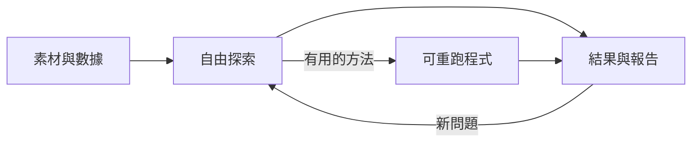

# 輕量分析專案：最多兩層

原則：資料找得到、原始資料不覆寫、重要結果有依據，其餘讓 AI 依題目決定。不強制 src 套件、run 資料夾、設定繼承或一套固定報表格式。

新專案由 lab-init 建立下列目錄；既有專案沿用已有位置，不自動搬移。目錄最多兩層，第二層中可直接放檔案。

```text
project/
├── research/           問題、筆記、來源與結論
├── materials/
│   ├── external/       外部文獻、文件、訪談
│   └── generated/      AI 摘要、提案與生成素材
├── data/
│   ├── raw/            原始數據，唯讀
│   ├── processed/      整理後的分析資料
│   └── features/       需要時才產生的特徵
├── analysis/
│   ├── notebooks/      即興探索、圖表與試驗
│   └── scripts/        需要重跑或共用的程式
├── config/             選用；需要抽離才存參數
├── reports/            分析結果、圖表、正式報告
└── artifacts/          模型、預測與必要執行紀錄
```

## 哪些固定，哪些自由

| 保留的底線 | 留給 AI 的選擇 |
| --- | --- |
| 原始資料不覆寫 | 用什麼檔案格式、如何清理與探索 |
| 外部與 AI 素材記來源、區分核對情況 | 摘要、筆記、截圖或引用連結皆可 |
| 重要結果能指出資料、程式、參數與輸出 | 用 notebook、Markdown、JSON 或現有紀錄即可 |
| 需學習資料的轉換遵守訓練切分 | 選何種特徵、模型及比較方法 |
| 採用成果避免被覆寫 | 用日期、題名、實驗編號命名即可 |

raw／processed 可類比銅／銀；features 是建模用途，不代表更可信。報表需要的彙總資料可直接放 processed，以檔名表達用途，不再新增金層專屬架構。小題目不必走完所有資料層。

研究素材若投入計算，將數據存入 data 並記來源。AI 生成數據需標明 synthetic，不能混成真實觀測。補值、縮放、target encoding 等只在訓練範圍 fit；快取特徵時記清使用的切分。

## 程式與設定怎麼放

先允許一份 notebook 完成探索。需要重跑或出現重複邏輯，再抽到 analysis/scripts；notebook 呼叫共用函式，不維護兩份相同演算法。沒有重用需求就不先蓋框架。

config 不要求共用：可以有 logistic.yaml、xgboost.yaml，也可以把簡單參數直接寫在 notebook 的參數區。重要比較記下實際用的參數；不用先實作設定載入器或每種模型的 schema。

範例：

```text
analysis/notebooks/churn-eda.ipynb
analysis/scripts/train_churn.py
config/churn-xgboost.yaml
reports/20261030-churn.md
reports/20261030-churn-pr.png
artifacts/churn-v2.pkl
artifacts/churn-v2.json
```

artifacts/churn-v2.json 可記資料版本、程式版本、有效參數、切分、指標及重跑方式。它不是必備格式，一份 notebook 或研究筆記能清楚記錄也可以。失敗試驗簡記原因；正式模型再補環境與載入驗證，不對每次靈感要求完整 manifest。

## 素材與成果保存

research/sources.md 記來源 URL／路徑、日期、生成條件與是否核對；不需要每份素材再開資料夾。研究文件可合併，初始化提供的模板都是選用，不是開工關卡。

數據、素材附件、reports 與 artifacts 預設不進 Git，重要結論與產物取回方式留在 research。僅在本機就說明限本機；需要共享時才配置外部保存方式。草稿不自動清除，被報告引用的唯一證據不能當暫存刪除。

既有專案的 ignore 規則會保留，不自動改寫；因此舊專案新增素材或特徵前要核對是否已有合適的忽略規則。初始化不替使用者管理既有資料。



已實作新專案的兩層骨架與檔案保留測試。未實作自動實驗追蹤平台，也不要求導入它。
