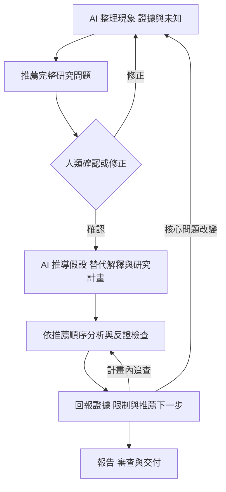

# 單一分析專案的研究流程

一個題目使用一個專案資料夾，新題目由使用者另開。AI 直接在目前專案工作，先想清楚問題、與人確認，再推導研究計畫及執行分析。

## 最小流程



問題定義與實際回覆記在 research/question.md，研究計畫記在 research/plan.md。已有相同問題的明確確認時引用既有紀錄，不重問；計畫內工作持續執行，只有重要邊界改變才重新確認。

方法 reference 見 [研究設計](../skills/ds-frame/references/research-design.md)，其中參考彭明輝著作的公開資料，並區分本專案的操作化設計。

## 文件與工作位置

| 位置 | 內容 |
| --- | --- |
| research/question.md | 決策、研究問題、範圍與實際確認 |
| research/plan.md | 假設依據、替代解釋、反證、方法、順序與停止條件 |
| research/hypotheses.md | 事前假設定義與判準 |
| research/findings.md | 觀測後的狀態、結果與證據引用 |
| research/sources.md | 領域、文獻與方法來源及限制 |
| research/handoff.md | 進度、待辦、資料使用情形與下一步 |
| data/raw/ | 原始快照與資料來源 |
| data/interim/、data/processed/ | 中間與分析資料，保留轉換方式 |
| analysis/ | Python、SQL、notebook |
| config/ | 分組、期間、切分與成本參數 |
| reports/explorations/ | 每輪獨立結果，避免覆寫先前探索 |
| reports/figures/、reports/tables/ | 報告採用圖表與計算表 |
| reports/decision.md、reports/review.md | 決策報告與審查紀錄 |

安裝套件後以 ds-init 在目前資料夾建立空白骨架，再依實際題目填寫。資料可在允許的外部來源，記清楚位置與取得方式；不同題目的暫存結果不自行混用。

## 夜班差異的例子

AI 先整理：「整體夜班良率較低，但產品、設備及負載可能不同。我建議問題定為：在可比較的產品、設備與負載下，班別與良率是否仍有具業務意義的關聯？此分析用來判斷是否值得現場調查。請確認問題、範圍與用途。」

確認後由 AI 擬定計畫：先檢查資料品質與組成，再比較可比群組，最後檢查不同期間是否穩定。每步說明依據、預測和反證；組成解釋不足時保留其他可能機制，不直接宣稱班別造成差異。

人類修正領域假設與資源邊界，AI 負責研究推論與推薦順序，不要求人逐一替 AI 選擇統計方法。

## 接續與交付

換對話時請 AI 閱讀研究問題、計畫和 handoff，先核對資料、程式與結果再續作。每輪保留實際命令、參數、資料範圍和限制；新增假說維持探索身分，避免看到結果才改寫事前問題。

交付前對照報告與證據審查，問題寫入 reports/review.md，重要未解事項先處理或清楚限制主張。資料、方法或結論改變後重查相關部分；不能以資料夾、檔名或模板存在證明分析正確。

## 對話範例

```text
使用 $decision-analysis。
這個資料夾就是本次分析專案，資料在 <來源位置>。
先推薦完整研究問題，向我確認後再擬定假設與分析計畫。
將資料、程式、參數和報告放入對應目錄，保留反證與替代解釋。
```
