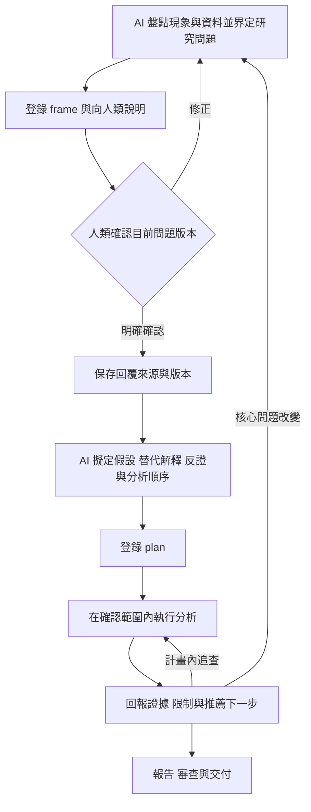

# 研究問題確認與獨立分析專案

AI 先整理問題、證據與未知，向人類確認研究問題；確認後由 AI 推導假設、替代解釋和推薦分析順序，再執行分析。人類負責領域校正與決策取捨，AI 負責提出有依據的研究設計。

## 從問題到計畫



問題確認前可盤點 Schema、樣本結構與可行性。若同一完整問題已有使用者明確回覆，保存該來源即可，不重問。計畫內的例行比較可持續執行；人類明定計畫需另審或重大範圍變動時，再取得相應確認。

研究方法 reference 見 [研究設計](../skills/ds-frame/references/research-design.md)。其中參考彭明輝著作的公開資料，並標明本專案自行轉譯的部分。

## 夜班差異如何提問與推導

AI 先綜合：「目前整體夜班良率較低，但產品、設備及負載組成不同，尚不能將差異歸於班別。我建議問題定為：在可比較的產品、設備與負載下，班別與良率是否仍有具業務意義的關聯？此分析用於判斷是否值得安排現場調查。請確認這個問題、範圍與用途。」

人類確認後，AI 再提出推薦計畫：先檢查資料品質與組成，再比較可比群組，最後檢查不同期間是否穩定。每步寫出依據、預測與反證條件。例如產品組成是替代解釋，若同產品群內仍有一致差異，僅靠產品組成就不足以解釋現象；即使如此，也不能直接宣稱班別造成差異。

人類可以修正領域假設或資源邊界，AI 不把統計方法與研究順序拆成沒有理由的選單。

## 一個題目一個目錄

```text
projects/
├── README.md
├── factory-quality/                  題目一
│   ├── README.md                     專案地圖
│   ├── research/
│   │   ├── question.md               問題定義，登錄為 frame
│   │   ├── plan.md                   確認後的研究計畫，登錄為 plan
│   │   ├── hypotheses.md             計畫使用的假設與反證判準
│   │   ├── findings.md               每輪假設檢查結果與狀態
│   │   ├── sources.md                文獻與領域來源
│   │   └── confirmations/            人類確認來源
│   ├── data/
│   │   ├── raw/                      原始快照
│   │   ├── interim/                  清理與對齊中間結果
│   │   └── processed/                分析資料
│   ├── analysis/                     Python SQL notebook
│   ├── config/                       參數與成本設定
│   ├── reports/
│   │   ├── explorations/round-001/    每輪結果，輪次目錄執行時建立
│   │   ├── figures/                  報告採用圖表
│   │   ├── tables/                   報告採用統計表
│   │   └── decision.md               決策草稿，整理時建立
│   ├── handoff.md                    交接骨架
│   ├── artifacts/                    Harness 快照
│   └── state.sqlite                  本題狀態
└── customer-retention/               題目二，使用相同骨架
```

新建：

```bash
python3 tools/ds_harness.py init --case projects/factory-quality --goal eda
python3 tools/ds_harness.py init --case projects/customer-retention --goal impact
```

兩個題目使用不同資料、程式、參數與輸出路徑。工具拒絕巢狀 case、將另一專案文件當作本題證據，以及直接登錄另一專案的工作檔為輸入。經允許的共用素材可在本題保存快照並記錄來源；不屬於其他 case 的外部唯讀來源仍可登錄雜湊。

`projects/` 只追蹤共用 README，個別專案預設忽略。本機路徑與狀態隔離不限制任意 Python 或 host 工具的權限，不能描述為 OS 沙盒。

## Agent 的操作契約

### 先登錄問題

由 ds-frame session 讀取研究骨架，完成 `research/question.md`，以 `record --stage frame` 登錄；記住工具回傳的 artifact ID，這是待確認版本。

### 有明確回覆後保存確認

收到人類針對該版本的明確回覆，才在本題 `research/confirmations/` 保存 JSON。格式如下，欄位內容必須來自實際回覆，這份格式本身不是已取得的確認：

```json
{
  "decision": "confirmed",
  "source": "user_message",
  "statement": "填入使用者對目前問題定義的明確回覆",
  "reference": "填入對話位置或可核對的使用者文件來源"
}
```

`source` 可為 `user_message` 或 `user_file`。然後執行：

```bash
python3 tools/ds_harness.py confirm --case projects/factory-quality \
  --session <ds-frame_session_id> --revision <frame_artifact_id> \
  --file projects/factory-quality/research/confirmations/problem.json
```

工具檢查來源欄位、確認快照及目前 frame 的版本，不認證使用者身分或訊息真偽；AI 必須如實記錄，不能自行代人類同意。問題或其輸入變更後，舊確認失效。

### 確認後登錄計畫

仍由 ds-frame 擬定 `research/plan.md`，以同一角色登錄 `--stage plan`。Plan 不新增一個技能名稱；八個技能保持原分工。

```bash
python3 tools/ds_harness.py record --case projects/factory-quality \
  --stage plan --session <ds-frame_session_id> \
  --file projects/factory-quality/research/plan.md \
  --input projects/factory-quality/research/hypotheses.md \
  --input projects/factory-quality/research/sources.md
```

Hypotheses 或來源若用於這版計畫，必須登錄；後續修訂會使相依計畫失效，需明確更新版本。每輪結果與狀態寫入 research/findings.md 及本輪報告，避免變更計畫綁定的假設定義。新增探索不直接回填成預先指定假設。需要正式採用計畫變更時，重算受影響的下游。

研究問題未確認時不能登錄計畫或後續分析；缺少有效 plan 時不能登錄 proxy、EDA、rules 或 impact。這些是 Harness 登錄與交付檢查，沒有攔截 agent 直接執行所有外部工具。

## 續作與舊 case

```bash
python3 tools/ds_harness.py status --case projects/factory-quality
```

Status 增加 `problem_confirmed` 與 `next_action`：`define_problem`、`await_problem_confirmation`、`write_research_plan`、`analyze` 或 `review_and_deliver`。`next_skill` 提示下一個角色，等待問題確認或寫計畫時均為 ds-frame。

舊 `.decision/cases/` 可維持原路徑查詢，不自動搬移輸入。缺少確認與 plan 的舊 case，先核對既有問題、取得明確確認並補計畫；新增上游會使既有分析和審查失效，重新登錄前須核對是否符合該計畫。舊 case 可能沒有新骨架，可手動建立需要的子目錄，不對已有目錄重新執行 init。

## 對話啟動範例

在 Codex 對話中輸入：

```text
使用 $decision-analysis，在 projects/factory-quality 建立新分析專案。
資料來源是 <資料位置>，資料字典是 <Schema 位置>。
先釐清並推薦研究問題，向我確認後，再推導研究假設與分析計畫。
將本題資料、程式、參數與報告放入對應目錄，保留反證與替代解釋。
```
