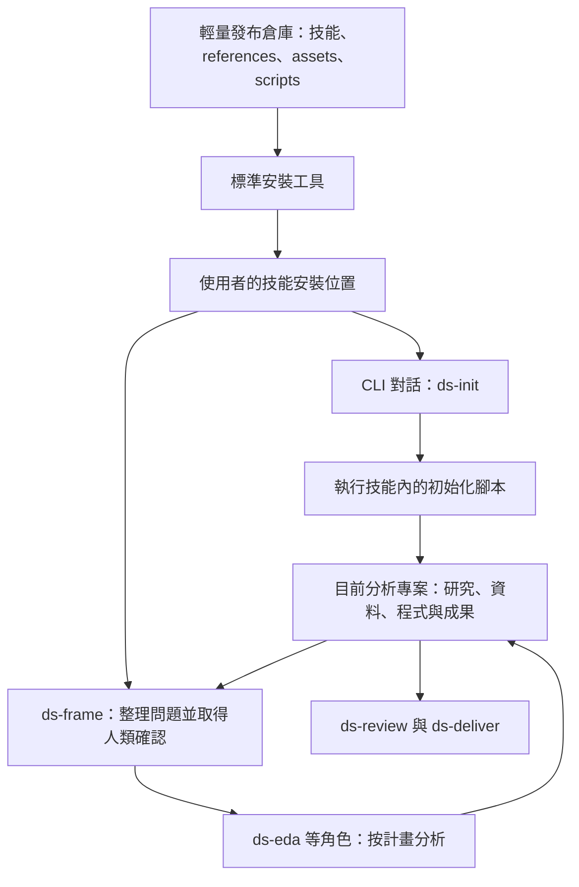

# 可安裝的資料科學技能套件設計

本文件是下一版的封裝規格。現行程式仍是 repository 內使用的八個分析技能；此處的 `ds-init`、發布目錄及安裝命令尚未實作或發布，不能視為現有功能。

## 產品定位與使用體驗

將研究方法、角色指令、references、報告模板與初始化腳本封裝成可安裝套件。安裝一次後，使用者在自己開的分析資料夾工作；一個資料夾對應一個分析題目。

建議採用 Archify 的安裝與資源封裝方式，搭配 gstack 的角色分工與文件交接；保留目前的研究推論要求。Archify 的官方入口示範安裝技能後直接用自然語言工作；gstack 則示範以多個技能承接不同工作責任。[Archify](https://github.com/tt-a1i/archify)、[gstack](https://github.com/garrytan/gstack)

預期的對話如下。這些是目標介面，不是目前可執行的新增命令：

```text
使用者在自己開的新資料夾啟動 Codex。

你：$ds-init 在目前資料夾初始化分析專案。
AI：建立 research/、data/、analysis/、config/、reports/。
    原有檔案保留，回報建立與略過項目。

你：$ds-frame 我想查夜班良率為何較低，資料在 data/raw/quality.csv。
AI：整理現象、決策需求與關鍵未知，推薦完整研究問題。

你：確認，範圍限定最近三個月的 A 產線。
AI：記錄實際確認，推導假設、替代解釋、反證條件與分析順序。

你：$ds-eda 依計畫分析。
AI：讀取本專案研究文件與技能內的方法參考，執行比較，
    回報效果量、不確定性、仍未排除的解釋及推薦下一步。
```

Claude Code 對應 `/ds-init`、`/ds-frame`、`/ds-eda`。使用者也可以說「使用 ds-init 初始化目前專案」；名稱與自然語言都是載入工作指令的入口。技能載入後由 agent 呼叫腳本，不代表 CLI 新增了一個獨立的 `ds-init` shell 程式。Claude 的技能指令與腳本能力見 [官方文件](https://code.claude.com/docs/en/skills)，Codex 的技能與本機探索機制見 [官方文件](https://learn.chatgpt.com/docs/build-skills)。

## 安裝位置與專案位置分開



| 位置 | 保存內容 | 變動時機 |
| --- | --- | --- |
| 技能安裝位置 | 工作指令、方法 references、模板與初始化腳本 | 安裝或升級套件 |
| 目前分析專案 | 問題、確認、計畫、資料、分析程式、設定與報告 | 分析過程 |

Codex 官方文件目前列出的使用者技能位置為 `~/.agents/skills/`，專案技能位置為 `.agents/skills/`；Claude Code 支援個人與專案的 `.claude/skills/`。實際安裝路徑交給安裝工具處理，分析技能不硬編碼家目錄。[Codex 技能位置](https://learn.chatgpt.com/docs/build-skills)、[Claude 技能位置](https://code.claude.com/docs/en/skills)

另一個分析題目由使用者另開資料夾，沿用已安裝技能。技能安裝區不保存商業資料或特定題目的記憶。

## 第一版的安裝方案

第一版採標準 Agent Skills 目錄與既有安裝工具，先完成兩個 CLI 共用的可攜資源；不另寫套件管理器。Vercel 的 skills CLI 支援選擇技能與 agent，並以 `-g` 提供跨專案安裝。[skills CLI](https://github.com/vercel-labs/skills)

發布倉庫暫名為 `ds-analysis-skills`，實際名稱發布時決定。以下僅示範安裝介面，`<owner>/<release-repo>` 需要替換成實際已發布的倉庫：

```bash
npx skills add <owner>/<release-repo> -g
```

安裝流程選擇完整分析套件與正在使用的 CLI。使用者不必逐一尋找九個技能；安裝文件提供完整套件的選取方式與可選角色清單。Node.js 是此安裝工具的前提，Python 是初始化腳本的執行前提；實際分析依使用者專案環境。

若後續需要在 Codex 的原生插件介面發行，再以同一組技能產物加上 plugin manifest。OpenAI 目前建議將可重用的多技能發行包封裝成 plugin；這可作為另一個安裝通路，無需重寫分析方法。[技能發行指引](https://learn.chatgpt.com/docs/build-skills)、[plugin 封裝](https://developers.openai.com/plugins/build/plugins)

## 發布內容：一個產品，九個技能入口

保留現有八個技能，只增加負責建立檔案的 `ds-init`。完整套件一次安裝，平常從初始化、問題定義與探索三個入口開始；其他角色在需要時使用。

| 入口 | 責任 | 工作產出 |
| --- | --- | --- |
| ds-init | 在目前資料夾建立空白骨架 | 研究骨架與資料／程式／報告目錄 |
| decision-analysis | 依現有研究文件推薦下一個角色 | 路由與理由 |
| ds-frame | 問題定義、人類確認與研究計畫 | research/ 的問題、假設、計畫、來源 |
| ds-proxy | 直接量測不足時設計代理假設 | research/proxy.md |
| ds-eda | 有目的的探索、比較與假設檢查 | 每輪結果與 findings |
| ds-rules | 提取與驗證可解釋候選規則 | reports/rules.md |
| ds-impact | 比較成本、情境與效益假設 | reports/impact.md |
| ds-review | 核對目前成果與實際證據 | reports/review.md |
| ds-deliver | 整理報告與交接 | reports/decision.md、research/handoff.md |

不同角色共用研究文件，不代表自動啟動多個 agent。只有 EDA 的題目可以直接收斂交付。

建議發布倉庫的安裝內容如下：

```text
ds-analysis-skills/
├── README.md                         安裝、開始與更新說明
├── LICENSE
└── skills/                           安裝器可發現的完整技能
    ├── ds-init/
    │   ├── SKILL.md
    │   ├── scripts/init_project.py
    │   └── assets/project/           空白研究文件、目錄與規約片段
    ├── decision-analysis/
    │   ├── SKILL.md
    │   └── references/               路由需要的共用約定
    ├── ds-frame/
    │   ├── SKILL.md
    │   └── references/               研究方法與共用約定
    ├── ds-eda/
    │   ├── SKILL.md
    │   ├── references/               方法選擇、相依資料、混雜、圖表
    │   └── assets/inquiry.md
    ├── ds-deliver/
    │   ├── SKILL.md
    │   ├── references/
    │   └── assets/                   探索摘要與決策報告骨架
    └── …                            proxy、rules、impact、review
```

每個可安裝技能都攜帶實際需要的資源。不依賴安裝器保留兄弟資料夾，也不要求使用者下載原始開發 repository。標準 SKILL.md 與安裝器的探索方式見 [Agent Skills 建立格式](https://github.com/vercel-labs/skills/blob/main/docs/creating-skills.md)。

## 資源路徑：現行版本必須先補的部分

目前的 ds-eda 會要求從 repository 根目錄讀取 `skills/ds-eda/references/…`，共用文件又會引用 `docs/`、`AGENTS.md` 與原始 PDF。`tools/render_skills.py` 目前只產生入口 Markdown，未將這些資源裝進各技能，因此現有 `.agents/skills/` 不能直接當成可攜套件發行。

下一版採兩種明確的路徑語意：

- 技能資源相對於「本次載入的 SKILL.md 所在位置」：references、scripts、assets。
- 分析資料與成果相對於「目前分析專案根目錄」：research、data、analysis、config、reports。

例如 ds-eda 的 `references/method-selection.md` 來自技能安裝區；`research/plan.md` 來自使用者專案。由 agent 從載入技能的實際位置解析腳本和資源，不猜測家目錄。Claude 支援 `${CLAUDE_SKILL_DIR}`，但共用版本不假設 Codex 會展開相同變數。[Claude 路徑替換規格](https://code.claude.com/docs/en/skills)

開發來源仍維護一份 `_shared/`。建置時將必要共用 references 複製到各技能並重寫相對連結，發行產物之間可以有小量重複；維護者不手動維護重複原稿。核心方法整理成具來源的輕量文件，原始課程 PDF 與 archive 不納入基本安裝。

## ds-init 的行為契約

ds-init 是一個小型、可重複執行的檔案建立動作。使用者在自己的題目資料夾叫用它，AI 解析技能內腳本的實際位置，再在目前專案執行。內部介面可以是：

```text
python3 "<已解析的技能位置>/scripts/init_project.py" --root .
```

`<已解析的技能位置>` 是規格示意，實作需傳入真實路徑並妥善引用參數。使用者日常只需要 `$ds-init` 或 `/ds-init`。

初始化產出：

```text
目前分析專案/
├── research/
│   ├── question.md
│   ├── plan.md
│   ├── hypotheses.md
│   ├── findings.md
│   ├── sources.md
│   └── handoff.md
├── data/
│   ├── README.md
│   ├── raw/
│   ├── interim/
│   └── processed/
├── analysis/README.md
├── config/README.md
└── reports/
    ├── README.md
    ├── explorations/
    ├── figures/
    └── tables/
```

初始化先檢查預計建立的路徑，再建立缺少的目錄和文件。既有檔案略過並保留使用者內容；遇到檔案／目錄衝突時回報具體路徑，不刪除或強制覆寫。明確指定的專案根目錄可解析為實際路徑；骨架內部路徑若透過符號連結指向外部，應回報而非沿連結寫入。

建立或擴充 `.gitignore` 時，只加入本套件管理的資料與產出排除區塊，不重複加入、不改寫既有其他規則。AGENTS.md／CLAUDE.md 只提供簡短專案說明；不存在時可建立，已存在時保留，必要接續規約仍由技能載入。題目名稱可稍後填，不因缺少名稱而阻擋建立骨架。

初始化回報建立、略過與衝突項目，然後指向 ds-frame。建立骨架不等於研究問題已確認，不能預填同意、研究數值或成功結果。也不在初始化時下載資料、安裝整套分析依賴或修改使用者全域 CLI 設定。

## 保留研究體驗，降低操作負擔

初始化完成後，AI 先完成問題意識與研究範圍的整理，與人類確認，再根據來源、領域機制及替代解釋寫出推薦計畫。方法依據繼續沿用目前的研究設計 reference；不將有理由的研究推論降成無理由的選單。

references 管方法與主張邊界，assets 管產出骨架，scripts 管穩定的機械操作。統計方法與圖型依問題選擇，圖表預設沿用 Seaborn／Matplotlib；不將分析演算法全部硬編進初始化工具。

每輪用文件記錄問題、方法、效果量、樣本、不確定性、反證及重現方式。接續時先讀 question、plan 與 handoff；不增加 case ID、角色 session、SQLite 或手動登錄命令。

## 從目前版本遷移的最小工作

| 工作 | 要改什麼 | 驗收方式 |
| --- | --- | --- |
| 新增 ds-init | SKILL.md、空白 assets 與初始化腳本 | 暫存空目錄建立成功；重跑不改檔；衝突清楚回報 |
| 改寫資源位置 | 技能內資源相對於技能、題目檔案相對於專案 | 移到任意安裝路徑，在另一空資料夾仍可使用 |
| 建置完整套件 | 產生 SKILL.md 並攜帶必要 references／assets／scripts | 掃描連結，確認無原 repository 的本機路徑依賴 |
| 輕量發布 | 從開發來源產出乾淨發布倉庫或可安裝發行分支 | 不包含 archive、真實資料、報告與個人環境 |
| 兩個 CLI 驗收 | 安裝、初始化、問題確認及接續 | 各留一份實際對話與產出，不以產生器測試替代 |
| 文件改版 | 首頁改成安裝、初始化、第一次分析三步驟 | 新使用者無需理解開發倉庫即可開始 |

保留目前原稿為單一維護來源，先在暫存位置驗證發行產物。安裝器的檢查／更新負責更新技能區，分析專案內容持續由使用者持有；技能升級不自動重寫研究、程式或報告。每個專案可在 handoff 記錄所用套件版本，重現分析仍需資料、程式、參數與環境依據。

本階段交付的是封裝規格；發布倉庫建立、套件實作與實際安裝驗收仍待完成。
