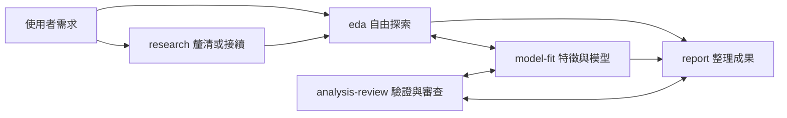

# 六個核心技能

不必背完整流程；也可以直接用自然語言描述需求，由 AI 選用技能。技能名稱不加 ds 前綴，避免使用原生的 init、model、review 等名稱。

| 指令 | 用途 | 合併進來的能力 |
| --- | --- | --- |
| lab-init | 準備分析工作目錄 | 輕量兩層骨架，保留既有檔案 |
| research | 釐清問題、開始或接續研究 | 問題定義、研究素材、方法選擇與下一步 |
| eda | 看資料、探索與繪圖 | 品質檢查、假說探索、代理訊號 |
| model-fit | 建立或改善模型 | 特徵工程、基準、調參、規則與推論 |
| analysis-review | 驗證與審查 | 切分、洩漏、模型比較、證據與產物檢查 |
| report | 整理成果 | 圖表、分析報告、交接及選用效益分析 |

只有 lab-init 手動啟動；其餘五個可手動，也可由 agent 按情境載入。方法參考藏在技能內按需讀取，不再增加使用者指令。原有 ds-* 入口已整併移除，不提供會造成重複選項的 alias。

## 怎麼用

Codex 使用 `$eda` 等技能語法；Claude Code 使用 `/eda`。OpenCode 安裝 commands 後使用 `/eda`，未安裝時可用自然語言要求載入。安裝方式見 [README](../README.md)。

```text
$lab-init 在這裡準備分析資料夾
$research 我想理解客戶流失，先看看資料能回答什麼
$eda 自由探索這份資料，找值得追問的現象
$model-fit 建立基準，再用最多 30 分鐘比較兩種方案
$analysis-review 檢查切分、資料洩漏和目前結論
$report 把目前有效發現整理成一份簡報式報告
```

目標清楚就開始，不要求先填問題表或固定計畫；需要正式比較或超出授權範圍時才補齊必要條件。特徵工程與優化是 model-fit 的工作，不需要再指定子技能。



箭頭是可選協作，不是必經關卡。只需要探索時就不建模；analysis-review 也可在訓練前協助驗證設計。

## 名稱與主機政策

2026-10-30 核對官方指令文件，以上六個名稱未出現在核對的原生命令列表。生成器拒絕已知原生保留名稱，包含 init、model、models、review、help、plan 等。這是已知名稱的防撞檢查，不是未來主機或第三方插件的永久保證；更新主機或新增技能時需再核對。

來源：[Claude Code Commands](https://code.claude.com/docs/en/commands)、[Codex commands](https://developers.openai.com/codex/cli/slash-commands)、[OpenCode TUI](https://opencode.ai/docs/tui/)。本機亦核對 codex --help；CLI 子命令與技能語法雖不同，仍避免相同名稱造成誤解。

Claude 的 lab-init 使用 disable-model-invocation，Codex 使用 allow_implicit_invocation: false。OpenCode 提供指令與行為約定，尚無等效的原生強制隔離。[OpenCode skills](https://opencode.ai/docs/skills/)

## 專案與能力範圍

- [兩層資料夾安排](project-layout.md)：素材、數據、探索與成果的彈性落點。
- [Kaggle 適用性](kaggle-readiness.md)：逐題核對限制，不承諾任何題目皆可執行。

已驗證套件生成、資源連結與初始化；尚未宣稱完成三種主機的端到端模型對話或 Kaggle 實跑驗收。
