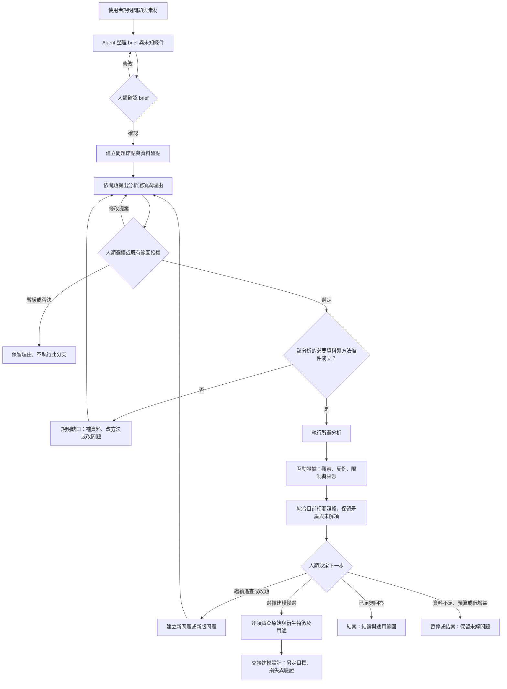
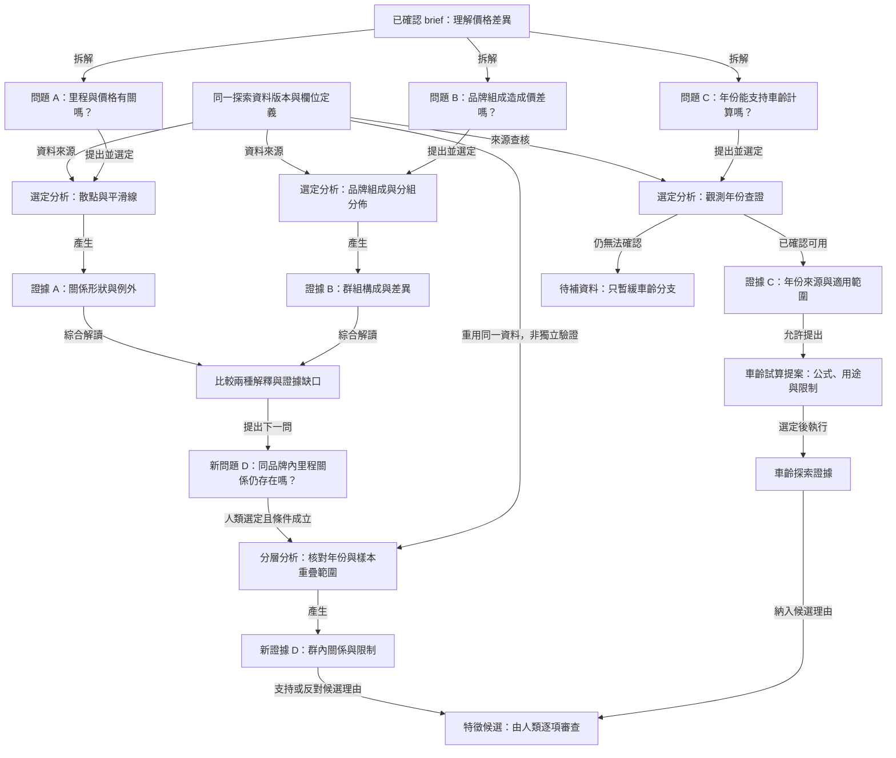

# 問題導向 EDA：操作流程與研究證據 DAG

日期：2026-10-29。狀態：設計圖，尚未實作。
承接 [EDA 設計](2026-10-29-question-led-eda-design.md)，本文件取代其原本順序式流程解讀。

## 先做的蘇格拉底邏輯審查

本次先讀取 [council-socrates 角色](https://github.com/0xNyk/council-of-high-intelligence/blob/main/agents/council-socrates.md)，再交由獨立子代理依 standalone 規範檢查前提與矛盾，完成後才整理圖形。
角色檔 SHA：`45c336e0e91eb2a6d851b847262e8a9c9ce03a6f`。
這是同一模型體系下的角色邏輯審查，不是多模型共識或實證驗證。

核心裁決：操作可以反覆，證據紀錄必須可追溯；兩者分開畫。這裡的 DAG 是研究依賴與來源紀錄，不是變數之間的因果圖。

| 盲點 | 修正 |
|---|---|
| 回到原問題時覆寫舊判斷 | 建立新版問題／提案，連到來源證據；保留舊版 |
| 同一資料跑三種方法就算三份獨立支持 | 共用來源明示；匯合是綜合解讀，不按分支數累加可信度 |
| 人類同意代表統計方法適用 | 授權、必要資料、方法前提分別檢查；不符只阻擋相關分支 |
| 每條分支做完才能下結論 | 各分析只等待必要依賴；其他分支可待選、暫緩或否決 |
| 動態探索沒有終點 | brief 定義決策用途與足夠條件；agent 建議停止，人類決定 |
| 來源改變卻繼續使用舊結論 | 將受影響後繼標為待重查，重算建立新版；不影響無關分支 |

## 圖一：研究操作流程

箭頭代表下一步操作，因此可以有回訪。這張圖不是儲存用的 DAG。
「單項分析」是可重複使用的局部流程，並不是全專案只有一條執行線；多個問題可以各自展開。

- brief 確認前只做必要素材／schema 查核；之後的資料盤點可以與無依賴的分析分支交錯進行。
- 人類可批次授權問題範圍、方法與預算，不要求逐張圖簽核。既有授權內的執行無須重問。
- 當前分支缺資料不凍結其他分支；替代方法仍需在授權範圍內，否則先提出建議。
- 執行失敗記錄錯誤，不產生成功證據；可在原授權與預算內修復重跑。無法修復時提出替代或暫停。
- 匯合只取目前相關且有效的證據，不要求所有待選問題都完成；缺少必要證據時只能給有限結論或標示未解。
- 特徵交接不要求整個研究圖關閉；仍須揭露會影響所選特徵的未知與限制。
- 停止理由分別記錄「足夠回答／無法回答／資源限制／人類取消」，不能全部標成研究成功。

## 圖二：具體研究 DAG

這是二手車問題的示意，尚未執行這些分析，也不預設結果。箭頭標明依賴或推導關係，沒有回到舊節點的邊。
核准及適用性檢查為每項分析的共同規則，為可讀性不在每條分支重畫。

圖中 A、B 的匯合不等待 C。D 仍使用相同資料，因此是後續探索，不是獨立確認。
F 代表逐項審查集合，不是必須等全部輸入到齊的執行閘門；任何候選的必要依賴未滿足，僅該候選不可進入交接。
未來可加入新的分支或直接停止，不需要先畫完整棵樹。實際每輪只向使用者顯示少量值得選擇的前沿問題。

## 紀錄與失效規則

1. 節點最少保留 ID、類型、版本、內容、來源引用與有效性資訊；分析另存方法、參數、樣本範圍與產物。
2. 關係具名：拆解、必要依賴、資料來源、產生、引用、修訂。跨節點共享必須記錄，不複製證據冒充不同來源。
3. 支持／反對某問題的解讀，由新的綜合判斷節點同時引用問題和證據；不從後來證據反向指回既有問題形成環。
4. 新版節點由舊版及新證據向前導出。來源變更新增失效／重審紀錄，保留原始結論與時間；歷史可讀，但過期結論不當成現行有效依據。
5. 同一證據可引用到多個問題；換樣本範圍、比較量、方法或資料版本時須重新檢查可用性，不能直接搬用結果。
6. 「已執行」「人類採用」「證據充分」分開保存。程式跑完不等於假說成立，也不代表人類已核准進模型。
7. 以本地 JSON 和既有 run 產物實作即可；首版不新增圖資料庫、排程服務或自動代理框架。

## 最小驗收情境

- 一份證據被兩個問題引用，仍顯示同一來源，不算兩次獨立驗證。
- 人類選定但方法不適用時，該分析停止並解釋；其他合法分支繼續。
- 暫緩年份查證，不阻擋無需車齡的里程與品牌分析。
- 新結果改變問題時，新增版本且 DAG 無環；舊結果可追溯。
- 資料版本改變，只有相關後繼需重審；舊授權不得自動擴張到新母體。
- 人類可因資料不足結案，產出未解問題而不強制建模。

本次僅完成設計圖與邏輯審查；上述情境是後續實作驗收要求，不是已執行的軟體測試。
